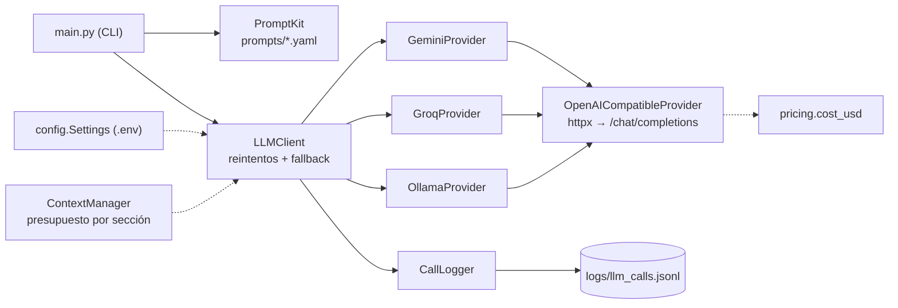

# Agente Operador

Proyecto integrador del **Bootcamp AI Engineer con Python — 2ª Edición: Agentes de IA en Producción** (Código Facilito).

El Agente Operador es un asistente para el equipo de operaciones de una empresa mediana: lee tickets (fallas, solicitudes, proveedores, facturación), los resume, los clasifica y, con el avance del bootcamp, actúa sobre ellos con herramientas, conocimiento interno y controles de producción.

- **Clase 1:** el núcleo (`core/`): un cliente LLM que habla con varios proveedores mediante el patrón adaptador, con reintentos, fallback, costo por llamada y logging estructurado.
- **Clase 2:** prompts versionados (`prompting/`, `prompts/`), contexto con presupuesto de tokens (`context/`) y pruebas de prompt injection.
- **Clase 3:** salida estructurada con contratos Pydantic y reparación (`contracts/`), y el primer tool call (`tools/`).
- **Clase 4:** agentes escritos a mano (`agents/`): ReAct y plan-and-execute, con presupuesto, motivos de parada y traza.
- **Clase 5:** herramientas con política (`agents/tools.py`): permisos por rol, topes, timeout, reintentos y errores tipados; una herramienta de escritura idempotente y un server MCP (`operador_mcp/`).
- **Clase 6:** RAG escrito a mano (`knowledge/`): ingesta, chunking, embeddings con Gemini, índice en ChromaDB y respuestas con citas.
- **Clase 7:** RAG agéntico: búsqueda híbrida (BM25 + vectores, fusionados con RRF), reescritura de la pregunta, re-ranking con el LLM y `buscar_documentos` como herramienta del agente.
- **Clase 8:** GraphRAG con NetworkX: un grafo de tickets, proveedores, equipos, guardias, servicios y chunks, construido con datos, reglas y el LLM; PageRank personalizado para preguntas de varios saltos y `consultar_grafo` como herramienta del agente.
- **Clase 9:** memoria (`memory/`): la sesión con historial y resumen (corto plazo), recuerdos con embeddings que el LLM consolida (largo plazo), y un router que decide si una pregunta va a la búsqueda, al grafo o a la memoria.

## Qué se construye en cada bloque

| Bloque | Clases | Qué agrega al Agente Operador |
|---|---|---|
| Fundamentos | 1–3 | Cliente LLM multi-proveedor, prompting, manejo de contexto y contratos de salida |
| Agentes | 4–5 | Ciclo de agente con herramientas para actuar sobre los tickets |
| Conocimiento | 6–9 | Búsqueda sobre documentación interna (RAG) y memoria |
| Orquestación | 10–11 | Flujos de varios pasos y coordinación entre agentes |
| Evaluación | 12–13 | Conjuntos de prueba y métricas de calidad |
| Producción | 14–17 | Streaming, observabilidad, costos y despliegue |

## Requisitos e instalación

- Python 3.11 o superior
- [uv](https://docs.astral.sh/uv/)

```bash
uv sync
cp .env.example .env
```

Llena tu `.env` con las llaves:

| Variable | Dónde obtenerla |
|---|---|
| `GEMINI_API_KEY` | Google AI Studio: <https://aistudio.google.com/apikey> (tiene free tier) |
| `GROQ_API_KEY` | Groq Console: <https://console.groq.com/keys> (tiene free tier) |
| — | Ollama corre local y no necesita llave: <https://ollama.com/download>, luego `ollama pull llama3.2` |

Si falta la llave de algún proveedor que está en `PRIMARY` o `FALLBACKS`, el programa falla al arrancar y te dice qué variable agregar.

## Comandos

Todo se corre con `uv run` desde la raíz del repo.

### `main.py`: la CLI del agente

```bash
# Pregunta al LLM (usa PRIMARY y, si falla, FALLBACKS)
uv run main.py "Resume este ticket: el portal de proveedores no carga desde las 9:00"

# Demo: solo Gemini, sin fallbacks, con el ticket T-1043 (funciona aunque GroqProvider esté pendiente)
uv run main.py --demo

# Fuerza un proveedor, sin fallbacks
uv run main.py --provider gemini "hola"
uv run main.py --provider groq "hola"
uv run main.py --provider ollama "hola"

# Clasifica un ticket de data/*.jsonl con un prompt versionado (Clase 2)
uv run main.py --prompt ticket_classifier --ticket T-1099                     # versión activa
uv run main.py --prompt ticket_classifier --prompt-version 1 --ticket T-1099  # versión específica
uv run main.py --prompt ticket_classifier "El ERP no abre desde la mañana"     # texto libre

# Salida estructurada y herramientas (Clase 3)
uv run main.py --structured --ticket T-1042
uv run main.py --tools "¿Cómo va el T-1042?"

# Agentes (Clase 4)
uv run main.py --agent react "Compara el estado del T-1042 y el T-1014: ¿cuál va más avanzado?"
uv run main.py --agent plan "Compara el estado del T-1042 y el T-1014: ¿cuál va más avanzado?"

# Herramientas con política y MCP (Clase 5)
uv run main.py --agent react --mcp "¿Cómo va el T-1042?"
uv run main.py --agent react --rol lectura "Marca el T-1042 como resuelto"

# RAG sobre los documentos de operaciones (Clase 6; antes corre scripts/ingest_docs.py)
uv run main.py --rag "¿Cuál es el tiempo de respuesta de PagosRed según su contrato?"
uv run main.py --rag "¿Cuándo escalo un ticket de prioridad alta?" --k 3 --embedder fake
uv run main.py --rag "¿Qué pasa si PagosRed no cumple el tiempo de respuesta?" --tipo contrato --proveedor PagosRed

# RAG agéntico (Clase 7): búsqueda híbrida, reescritura, re-ranking y el agente con documentos
uv run main.py --rag "¿Qué pasó con el T-1016?" --modo hibrida
uv run main.py --rag "¿Cuánto tardan los de pagos en contestar?" --modo hibrida --reescribir --rerank
uv run main.py --agent react --docs "El T-1042 lleva 6 horas sin respuesta de PagosRed. ¿Ya hay que escalar?"

# GraphRAG (Clase 8; antes corre scripts/build_graph.py)
uv run main.py --rag "¿Qué penalización aplica si el proveedor del T-1042 no responde a tiempo?" --modo grafo
uv run main.py --agent react --docs --grafo "El T-1043 lleva 3 horas sin respuesta del proveedor, ¿ya incumplió su contrato?"

# Memoria y router (Clase 9; antes importa data/memorias_demo.jsonl con scripts/memoria.py)
uv run main.py --agent react --sesion demo "¿Cómo va el T-1043?"
uv run main.py --agent react --sesion demo "¿Y quién lo atiende?"
uv run main.py --rag "¿Qué quedé de revisar con PagosRed?" --modo auto
uv run main.py --agent react --docs --grafo --memoria "¿Qué me falta para cerrar el T-1022?"

# Reanudar una ejecución que falló (reto de la Clase 9); --falla-en simula la caída del proveedor
uv run main.py --agent react --ejecucion r1 --falla-en 3 "Compara el T-1042 y el T-1043"
uv run main.py --agent react --reanudar r1
```

Cada llamada imprime la respuesta y una línea gris con `proveedor · modelo · tokens in/out · latencia · costo`, y agrega una línea JSON por intento a `logs/llm_calls.jsonl`. Con `--prompt`, el log incluye `prompt_name` y `prompt_version`.

### Scripts

```bash
# Reporte de las llamadas registradas en logs/llm_calls.jsonl (reto de la Clase 1)
uv run scripts/report.py

# Compara versiones de un prompt sobre los 20 tickets etiquetados y los tickets de ataque
uv run scripts/compare_prompts.py ticket_classifier --versions 1 2
uv run scripts/compare_prompts.py ticket_classifier --versions 2 3 --no-attack
uv run scripts/compare_prompts.py ticket_classifier --versions 2 --provider ollama

# Muestra cómo el ContextManager recorta un historial largo (no llama al LLM)
uv run scripts/context_demo.py
uv run scripts/context_demo.py --budget-history 120

# Salida estructurada: texto libre vs json_schema vs Pydantic con reparación (Clase 3)
uv run scripts/compare_structured.py
uv run scripts/compare_structured.py --limit 8 --modes texto pydantic

# Tool loop vs ReAct vs plan-and-execute (Clase 4)
uv run scripts/compare_agents.py --repeat 3

# RAG (Clase 6): indexar data/docs y medir hit@k del retrieval
uv run scripts/ingest_docs.py data/docs
uv run scripts/eval_retrieval.py --k 1 3 5

# Tamaño de chunk y umbral con el golden set v2 (reto de la Clase 6)
uv run scripts/compare_chunking.py --report reports/chunking.md

# Modos de búsqueda sobre el golden set v3 (Clase 7); los modos con + llaman al LLM
uv run scripts/eval_retrieval.py --modos vector bm25 hibrida --detalle
uv run scripts/eval_retrieval.py --modos hibrida hibrida+rerank

# Preguntas de varios saltos: recall@5 de las fuentes por modo (reto de la Clase 7)
uv run scripts/eval_multihop.py --modos vector hibrida hibrida+rerank --report reports/multihop.md

# Grafo de conocimiento en var/grafo.json (Clase 8): sin LLM, con LLM y sus comunidades
uv run scripts/build_graph.py
uv run scripts/build_graph.py --llm --comunidades
uv run scripts/eval_multihop.py --modos hibrida grafo hibrida+grafo --detalle

# El golden del reto de la Clase 8 (router_v1); la regla de hoy ya incluye la memoria
uv run scripts/eval_router.py --golden data/golden/router_v1.jsonl --detalle

# Memoria de largo plazo en var/memoria.json (Clase 9)
uv run scripts/memoria.py importar data/memorias_demo.jsonl
uv run scripts/memoria.py buscar "¿A quién escalé el T-1043?"
uv run scripts/memoria.py consolidar --sesion demo

# Router: la regla y el LLM eligen búsqueda, grafo o memoria (Clase 9); --llm llama al LLM
uv run scripts/eval_router.py --llm --detalle --report reports/router.md
```

`compare_prompts.py` usa un solo proveedor sin fallback (el primario o el de `--provider`). `main.py --prompt` usa solo el primario si la cadena de fallbacks no se puede armar (por ejemplo, mientras `GroqProvider` esté pendiente).

### Tests y calidad de código

```bash
uv run pytest -q              # no usan red
uv run ruff check .
uv run ruff format --check .
```

### Datos

| Archivo | Contenido |
|---|---|
| `data/tickets_ejemplo.jsonl` | 10 tickets para la demo de la Clase 1 |
| `data/tickets_etiquetados.jsonl` | 20 tickets con su categoría (4 por categoría) para evaluar prompts |
| `data/tickets_ataque.jsonl` | Tickets con prompt injection, incluido `T-1099` |
| `prompts/ticket_classifier/examples.jsonl` | 10 ejemplos para few-shot (no se repiten con los de evaluación) |
| `data/tickets_db.json` | 50 tickets (`T-1001` a `T-1050`) con estado, equipo, proveedor e historial; los lee `buscar_ticket` |
| `data/proveedores.json` | 6 proveedores ficticios con servicio, SLA, estado y contacto (práctica de la Clase 3) |
| `data/docs/` | 12 documentos ficticios de Acme Operaciones: 3 runbooks, 3 políticas, 3 contratos en PDF y 3 FAQ (Clase 6) |
| `data/golden/rag_v1.jsonl` | 10 preguntas con su fuente esperada y 1 fuera del corpus, para `eval_retrieval.py` |
| `data/golden/multihop_v1.jsonl` | 6 preguntas que necesitan 2 documentos, con sus `fuentes_esperadas`, para `eval_multihop.py` |
| `data/golden/router_v1.jsonl` | Las 20 preguntas con fuente de `rag_v3` y las 6 de `multihop_v1`, con su `fuente_preferida` (`busqueda` o `grafo`), para `eval_router.py` |
| `data/golden/router_v2.jsonl` | `router_v1` más 4 paráfrasis de preguntas de varios saltos y 8 preguntas sobre lo que contó el usuario: `fuente_preferida` es `busqueda`, `grafo` o `memoria` |
| `data/memorias_demo.jsonl` | 8 recuerdos de un usuario ficticio (equipo, guardia, pendientes, preferencias) para `scripts/memoria.py importar` y `eval_router.py` |

## Arquitectura



| Archivo | Responsabilidad |
|---|---|
| `core/config.py` | `Settings` leída de `.env`; valida llaves al arrancar |
| `core/errors.py` | Errores transitorios (se reintentan) y permanentes (fallback directo) |
| `core/providers.py` | `Provider` (Protocol), adaptador base compatible con OpenAI y uno por proveedor |
| `core/llm_client.py` | `LLMResponse` y `LLMClient`: backoff 1 s → 2 s → 4 s + jitter, fallback en orden, `log_extra` |
| `core/logger.py` | Una línea JSON por intento, sin llaves ni texto del prompt |
| `core/pricing.py` | Precio por millón de tokens y costo por llamada |
| `prompting/promptkit.py` | `PromptKit` y `Prompt`: carga YAML versionados y los renderiza con Jinja2 |
| `context/manager.py` | `ContextManager`: arma el contexto respetando un presupuesto de tokens por sección |
| `contracts/ticket.py` | `TicketClassification`: contrato de salida del triage |
| `contracts/structured_output.py` | `generate_structured`: pide JSON, lo valida con Pydantic y repara |
| `contracts/tool_schemas.py` | `ToolSpec` y `BUSCAR_TICKET`: qué recibe cada herramienta y cómo se describe |
| `contracts/tool_loop.py` | `run_tool_loop` y `execute_tool`: el ciclo de herramientas con `MAX_ITERS` |
| `tools/tickets.py` | `buscar_ticket` sobre `data/tickets_db.json` |
| `core/usage.py` | `UsageMeter`: llamadas, tokens, costo y latencia dentro de `LLMClient.track()` |
| `agents/budget.py` | `AgentBudget` y `StopReason`: límites del agente y motivos de parada |
| `agents/trace.py` | `TraceStep` y `AgentResult`: la traza y el resultado de un recorrido |
| `agents/react_agent.py` | `AgentStep` y `ReActAgent`: el ciclo ReAct |
| `agents/planner.py` | `Paso`, `Plan` y `PlanAndExecute`: planner, executors, replan y síntesis |
| `agents/tools.py` | `ToolPolicy`, `POLITICAS`, `ROLES` y `ToolRunner`: el filtro antes de ejecutar una herramienta |
| `operador_mcp/server.py` | Server MCP (`MCPServer`) con las herramientas, delegando en un `ToolRunner` |
| `operador_mcp/client.py` | `MCPToolset`: lanza el server por stdio y expone sus tools como `ToolSpec` |
| `var/` | Estado local de las herramientas (`var/*.json`, fuera de git) |
| `knowledge/ingest.py` | `Document`, loaders de Markdown, TXT y PDF, y `clean_text` |
| `knowledge/chunking.py` | `Chunk` y las estrategias fija, recursiva y por encabezados |
| `knowledge/embeddings.py` | `GeminiEmbedder` (con caché SQLite), `FakeEmbedder` y los prefijos de tarea |
| `knowledge/store.py` | `VectorStore` sobre ChromaDB: indexar, borrar, buscar; `EmbeddingMismatch` |
| `knowledge/rag.py` | `answer`: busca, filtra por umbral, responde con citas validadas |

## Clase 2: prompt engineering y context engineering

- **Prompts versionados:** los prompts salen del código y viven en YAML con versión. Así se comparan versiones con datos, se registra en el log qué versión respondió y se cambia de versión sin tocar Python.
- **Contexto con presupuesto:** el `ContextManager` reparte tokens por sección (system, ejemplos, historial, documentos, pregunta y salida reservada). Si algo no cabe, descarta lo de menor prioridad y más antiguo, y nunca recorta el system.
- **Prompt injection:** los tickets de `data/tickets_ataque.jsonl` intentan darle órdenes al clasificador. Los delimitadores de la v2 reducen el riesgo, pero no lo eliminan.

### Formato de un archivo de prompt

Cada prompt vive en `prompts/<nombre>/v<N>.yaml`:

```yaml
name: ticket_classifier        # igual al nombre de la carpeta
version: 2                     # igual al número del archivo (v2.yaml)
active: true                   # exactamente una versión activa por prompt
description: Clasificador con delimitadores y categoría "otro".
model_params:                  # se pasan tal cual al proveedor
  temperature: 0
  max_tokens: 10
system: |
  Eres el clasificador de tickets del equipo de operaciones de {{ company }}.
  ...
user: |
  <ticket>{{ ticket }}</ticket>
```

- Las plantillas son Jinja2 con `StrictUndefined`: si falta una variable, falla y dice cuál.
- `categories` y `examples` (de `examples.jsonl`, si existe en la carpeta) están disponibles en la plantilla sin pasarlos.
- `PromptKit().get("ticket_classifier")` devuelve la versión con `active: true`; `get("ticket_classifier", 1)` devuelve la v1 aunque no esté activa. Si hay cero o más de una activa, falla y dice qué archivos revisar.
- Categorías válidas: `falla`, `solicitud`, `proveedor`, `facturacion`, `otro`.

## Clase 3: salida estructurada, contratos y primer tool call

- **Salida estructurada:** `generate_structured()` pide al modelo un JSON que cumpla un modelo Pydantic y lo valida localmente con `model_validate_json()`.
- **Contrato `TicketClassification`** (`contracts/ticket.py`): `razon` va primero a propósito (el modelo justifica antes de decidir), `categoria` y `prioridad` son `Literal`, `resumen` tiene máximo 280 caracteres y un validador exige prioridad alta si hay una caída.
- **Reparación:** si la respuesta no valida, se agrega al historial la respuesta cruda y el error en lenguaje claro, y se reintenta (máximo `max_repairs`). Un error del proveedor no se repara: se propaga.
- **Primer tool call:** `buscar_ticket` (`tools/tickets.py`) con su contrato `ToolSpec` y el ciclo mínimo `run_tool_loop` (`contracts/tool_loop.py`): `for` con `MAX_ITERS = 3`, nunca `while True`. Los errores de herramientas se le regresan al modelo como `{"error": ...}`, sin traceback.

### Capacidades por proveedor

Verificado el 2026-10-09 en la documentación oficial. La estrategia de `generate_structured` depende del proveedor primario: `json_schema` estricto, si no `json_object` más el schema en el system, y si no solo el schema en el system.

| Proveedor | `supports_tools` | `supports_json_schema` | `supports_json_object` | Documentación |
|---|---|---|---|---|
| Gemini | ✅ | ✅ | ❌ (no documentado) | [OpenAI compatibility](https://ai.google.dev/gemini-api/docs/openai), [Structured output](https://ai.google.dev/gemini-api/docs/structured-output) |
| Groq (`openai/gpt-oss-*`) | ✅ (defaults de la clase base) | ✅ | ✅ | [Tool use](https://console.groq.com/docs/tool-use), [Structured outputs](https://console.groq.com/docs/structured-outputs) |
| Ollama | ✅ | ❌ (no confirmado) | ✅ (JSON mode) | [OpenAI compatibility](https://docs.ollama.com/api/openai-compatibility) |

Detalles que importan:

- **Gemini 3** regresa cada tool call con `extra_content` (su *thought signature*). Hay que reenviarlo tal cual en el siguiente turno; si falta, responde 400. `ToolCall` lo guarda y `LLMResponse.as_message()` lo devuelve.
- **Groq** con `strict: true` exige `additionalProperties: false` y que todas las propiedades estén en `required`. `openai/gpt-oss-120b` no soporta tool calls en paralelo y la página no menciona `tool_choice`.
- **Ollama** no soporta `tool_choice`.
- **Schema que se envía:** `sanitize_schema()` quita `maxLength`, `minLength`, `pattern`, `title` y `default`, y resuelve `$defs`. Solo cambia la copia que se manda; Pydantic sigue validando el modelo completo en local.

### Comandos

```bash
# Triage con salida estructurada (imprime un TicketClassification en JSON)
uv run main.py --structured --ticket T-1042

# Pregunta con herramientas: muestra cada tool call (→) y su resultado (←)
uv run main.py --tools "¿Cómo va el T-1042?"
uv run main.py --tools "¿Cómo va el T-9999?"     # la herramienta regresa un error y el modelo lo explica
```

Cada llamada queda en `logs/llm_calls.jsonl` con `structured_schema` y `repair_attempt` (salida estructurada) o `tool_iteration` y `tool_calls` (solo los **nombres** de las herramientas pedidas, nunca sus argumentos).

## Clase 4: qué es un agente (ReAct y plan-and-execute)

**Workflow vs agente.** En un workflow, el código decide el orden de los pasos y el modelo solo llena huecos (como el triage de la Clase 3). En un agente, el modelo decide el siguiente paso con lo que va observando. Eso da flexibilidad y también riesgo: un agente necesita límites explícitos para no dar vueltas, gastar de más o colgarse.

**ReAct** (`agents/react_agent.py`). Un ciclo de *razonar → actuar → observar*. En cada paso el modelo devuelve un `AgentStep` estructurado (`pensamiento`, `accion`, `herramienta`, `argumentos_json`, `respuesta`), validado con `generate_structured` de la Clase 3. Si pide una herramienta, `execute_tool` la ejecuta y la observación entra a la `<traza>` del siguiente paso. El contexto se reconstruye en cada paso y las observaciones de más de 1,500 caracteres se recortan.

**Plan-and-execute** (`agents/planner.py`). Primero el planner produce un `Plan` de 1 a 5 pasos sin ejecutar nada. Después, cada paso lo resuelve un `ReActAgent` con presupuesto local (`max_pasos=2`) y los resultados anteriores como contexto. Si un paso falla (sin respuesta o con `error`), se replanea una vez. Al final, una síntesis arma la respuesta. El presupuesto global cubre todo: planner, executors, replan y síntesis.

### Motivos de parada y presupuesto

`AgentBudget` se consulta **antes** de cada paso. Valores por defecto: `max_pasos=6`, `max_tokens=12_000`, `max_usd=0.02` y `max_segundos=45`.

| Motivo | Cuándo |
|---|---|
| `respuesta` | El modelo eligió `responder`: terminó bien |
| `max_pasos` | Se llegó al máximo de pasos |
| `presupuesto` | Se llegó al máximo de tokens o de USD |
| `sin_progreso` | Repitió la misma herramienta con los mismos argumentos (práctica guiada) |
| `timeout` | Se acabó el tiempo |
| `error` | El modelo no produjo un paso válido tras las reparaciones, o el proveedor falló |

Cada llamada queda en `logs/llm_calls.jsonl` con `agent_kind` (`react` o `plan`), `agent_run_id` y `agent_step`. El último evento de cada recorrido lleva además `stop_reason`. El uso de un recorrido se mide con `LLMClient.track()` (`core/usage.py`).

### Comandos

```bash
uv run main.py --agent react "Compara el estado del T-1042 y el T-1014: ¿cuál va más avanzado?"
uv run main.py --agent plan "Compara el estado del T-1042 y el T-1014: ¿cuál va más avanzado?"
uv run main.py --agent react --verbose "¿Cómo va el T-9999?"   # pensamientos y observaciones completas

# Tool loop (Clase 3) vs ReAct vs plan-and-execute con 4 preguntas fijas
uv run scripts/compare_agents.py
uv run scripts/compare_agents.py --repeat 3
```

Salida real de `--agent react` con `gemini-3.5-flash-lite` (con `plan`, antes se imprime el plan):

```
[1] buscar_ticket T-1042   [2] buscar_ticket T-1014   [3] responder
El ticket T-1042 está en estado "en revisión" con un reembolso ya en proceso, mientras que el T-1014 está en estado "esperando proveedor" [...]. Por lo tanto, el T-1042 va más avanzado en su resolución.
motivo: respuesta · 3 llamadas · 2,301 tokens · $0.001509
```

Referencia de `compare_agents.py` (una corrida, `gemini-3.5-flash-lite`, sin `consultar_proveedor`):

| modo | pregunta | llamadas | tokens | costo |
|---|---|---|---|---|
| tool_loop | dos tickets | 2 | 849 | $0.00045 |
| react | dos tickets | 3 | 2,211 | $0.00140 |
| plan | dos tickets | 6 | 3,771 | $0.00275 |

Las tres respondieron bien; la diferencia es cuánto cuesta llegar. Un agente vale la pena cuando la tarea necesita decidir sobre la marcha, no por defecto.

Si el motivo no es `respuesta`, la CLI lo explica y termina con código de salida 2. T-1042 y T-1014 dependen del mismo proveedor (PagosRed).

## Clase 5: tools y acciones, de herramientas locales a MCP

**Diseño de herramientas.** Una herramienta es un contrato para el modelo: un nombre claro, una descripción que diga qué hace, cuándo usarla y cuándo **no**, y argumentos con tipos y restricciones (`contracts/tool_schemas.py`). La descripción de `actualizar_estado` dice que *fija* el estado (no lo alterna) y que no se use sin un pedido explícito del usuario.

**Taxonomía de errores.** Toda herramienta regresa errores con la misma forma, `tool_error(tipo, mensaje, reintentable=..., sugerencia=...)`:

| `tipo` | Qué significa | ¿Reintentar igual? |
|---|---|---|
| `validacion` | Argumentos inválidos o herramienta inexistente | Solo corrigiendo los argumentos |
| `negocio` | La operación no tiene sentido (el ticket no existe) | No |
| `transitorio` | Timeout o falla pasajera | Sí, si es idempotente (lo hace el runner) |
| `permanente` | El handler falló de forma inesperada (el detalle va al log, no al modelo) | No |
| `permiso` | El rol no puede usar esa herramienta | No |
| `limite` | Se acabaron las llamadas permitidas en esta ejecución | No |

**Idempotencia.** `actualizar_estado` fija un valor: llamarla dos veces con el mismo estado deja el mismo resultado y la segunda regresa `"cambio": false`. Por eso se puede reintentar sin miedo. Escribe en un overlay, `var/tickets_estado.json`, con escritura atómica; `data/tickets_db.json` nunca cambia y `buscar_ticket` aplica el overlay al leer.

**`ToolPolicy` y roles** (`agents/tools.py`). Cada herramienta tiene un permiso (`lectura`, `escritura` o `peligrosa`), un timeout, si es idempotente y un máximo de llamadas por ejecución. El rol `lectura` solo puede leer; `operador` lee y escribe. Una herramienta sin política se trata como `peligrosa` y se niega, y `peligrosa` no se permite en ningún rol: la aprobación humana llega en la Clase 11. `ToolRunner.execute` revisa en este orden: permiso → llamadas restantes → argumentos → ejecución con timeout → reintento (0.5 s, 1 s) solo si el error es transitorio y la herramienta es idempotente. Cada ejecución se registra en `logs/tool_calls.jsonl` con `tool_name`, `tool_permiso`, `tool_resultado` y `tool_intentos`, nunca con los argumentos. El timeout corre el handler en un hilo: si se vence, dejamos de esperarlo, pero Python no puede matar el hilo.

**MCP** (*Model Context Protocol*). Un estándar para que un **host** (la app con el modelo, aquí `main.py`) use herramientas de un **server** a través de un **client** que habla el protocolo. El server declara sus tools (nombre, descripción, `inputSchema`, annotations) y el cliente las lista con `tools/list` y las llama con `tools/call`. Con el transporte **stdio**, el host lanza el server como subproceso y se comunican por stdin/stdout. `operador_mcp/server.py` expone las mismas herramientas con el mismo `ToolRunner` (rol en `OPERADOR_ROL`, por defecto `lectura`), y `operador_mcp/client.py` (`MCPToolset`) las convierte en `ToolSpec` para el agente. Las annotations (`readOnlyHint`, `destructiveHint`, `idempotentHint`) salen de la política; son pistas para el cliente, no seguridad.

### Comandos

```bash
# Agente con herramientas locales y ToolRunner (rol operador por defecto)
uv run main.py --agent react "¿Cómo va el T-1042?"
uv run main.py --agent react --rol lectura "Marca el T-1042 como resuelto"   # error de permiso

# Agente con las herramientas del server MCP por stdio
uv run main.py --agent react --mcp "¿Cómo va el T-1042?"
uv run main.py --agent react --mcp --rol operador "Marca el T-1042 como resuelto"

# Server MCP solo (stdio) y el Inspector oficial para probarlo sin LLM
uv run python -m operador_mcp.server
npx @modelcontextprotocol/inspector uv run python -m operador_mcp.server
```

El server lleva la cuenta de `max_llamadas` mientras vive: en una sesión larga del Inspector, cada herramienta acepta 3 llamadas y después regresa `limite`. Reinicia el server para volver a empezar. Su stderr (logs) queda en `logs/mcp_server.log` cuando lo lanza `MCPToolset`. Para borrar los cambios de estado, borra `var/tickets_estado.json`.

### Lo que verificamos en la documentación (16 de octubre de 2026)

| Tema | Lo que dice la documentación | Diferencia con las slides |
|---|---|---|
| Versión del SDK | `mcp` 2.3.0 en PyPI ([migración a v2](https://py.sdk.modelcontextprotocol.io/migration/)) | Las slides usan la API v1 |
| Declarar un server | `from mcp.server.mcpserver import MCPServer`; `MCPServer("agente-operador")` ([tools](https://py.sdk.modelcontextprotocol.io/servers/tools/)) | `FastMCP` se renombró a `MCPServer`; `mcp.server.fastmcp` ya no existe |
| Registrar tools | `@mcp.tool()` o `mcp.add_tool(fn, name=, description=, annotations=)` | Usamos `add_tool` para tomar la descripción del `ToolSpec` |
| Annotations | `ToolAnnotations(read_only_hint=..., destructive_hint=..., idempotent_hint=...)` de `mcp.types` | En Python son snake_case; en el protocolo siguen siendo `readOnlyHint`, etc. |
| Errores de una tool | `raise ToolError(...)` → `is_error=True` con el mensaje en `content` ([errores](https://py.sdk.modelcontextprotocol.io/servers/handling-errors/)) | Una excepción inesperada solo manda `Error executing tool X` |
| Cliente por stdio | `Client(StdioServerParameters(command=, args=, env=, cwd=))`; `stdio_client(params, errlog=...)` para redirigir stderr ([transportes](https://py.sdk.modelcontextprotocol.io/client/transports/)) | `ClientSession` sigue existiendo, pero la doc recomienda `Client`; el hijo no hereda el entorno salvo una lista mínima |
| Respuesta de `call_tool` | `content`, `structured_content`, `is_error` (snake_case en Python, camelCase en el protocolo) ([spec, tools](https://modelcontextprotocol.io/specification/latest/server/tools)) | `structuredContent`/`isError` solo en el JSON |
| Tools con `dict` | Un `dict[str, ...]` regresa como `structured_content` sin envolver ([salida estructurada](https://py.sdk.modelcontextprotocol.io/servers/structured-output/)) | — |
| Transporte en memoria | `Client(server)` despacha directo, sin JSON-RPC ([testing](https://py.sdk.modelcontextprotocol.io/get-started/testing/)) | `tests/test_mcp.py` usa ambos: memoria y stdio real |
| Especificación | Versión 2026-07-28: las annotations son pistas no confiables salvo de servers confiables | — |

## Clase 6: RAG, el agente aprende a leer documentos

**RAG** (*Retrieval-Augmented Generation*) es responder con documentos propios en lugar de con lo que el modelo memorizó. Tiene dos carriles. El de **ingesta** corre antes, una vez por cambio: lee cada archivo de `data/docs/`, lo limpia, lo parte en chunks, calcula un embedding por chunk y lo guarda en el índice. El de **consulta** corre en cada pregunta: calcula el embedding de la pregunta, recupera los `k` chunks más cercanos, descarta los que están más lejos que `UMBRAL` y le pide al modelo que responda solo con ellos, citando cada dato con `[n]`. Si nada pasa el umbral, no se llama al LLM: la respuesta es `No encontré eso en los documentos de operaciones.`

| Pieza | Archivo | Idea clave |
|---|---|---|
| Ingesta | `knowledge/ingest.py` | Un `Document` por archivo o por página de PDF; `clean_text` une guiones, quita encabezados y pies repetidos y colapsa espacios; `hash` del texto limpio |
| Chunking | `knowledge/chunking.py` | Runbooks y políticas por encabezados (`seccion` = "Escalamiento > Prioridad alta"); contratos recursivo; FAQ fijo con 15% de traslape |
| Embeddings | `knowledge/embeddings.py` | `gemini-embedding-2` sin `task_type`: prefijos `title: … \| text: …` y `task: search result \| query: …`; caché por modelo, dimensión y texto |
| Índice | `knowledge/store.py` | ChromaDB con distancia coseno; la colección guarda modelo y dimensión y se niega a abrirse con otro embedder |
| Respuesta | `knowledge/rag.py` | `RagAnswer` validado con `generate_structured`; una cita fuera de rango se repara una vez |

La ingesta es idempotente: un archivo con el mismo `hash` se salta y uno que cambió se borra y se reindexa completo, así que no quedan chunks huérfanos.

### Comandos

```bash
# Indexar (gemini por defecto; --rebuild borra el índice y reindexa todo)
uv run scripts/ingest_docs.py data/docs
uv run scripts/ingest_docs.py data/docs --rebuild

# Preguntar
uv run main.py --rag "¿Cuál es el tiempo de respuesta de PagosRed según su contrato?"
uv run main.py --rag "¿Qué pasa si PagosRed no cumple el tiempo de respuesta?" --k 3

# Medir el retrieval sin LLM: hit@k y la distancia de la pregunta fuera del corpus
uv run scripts/eval_retrieval.py --k 1 3 5

# Sin cuota ni red: embedder falso (bolsa de palabras); reemplaza el índice de .chroma/
uv run scripts/ingest_docs.py data/docs --embedder fake --rebuild
uv run main.py --rag "¿Cómo reinicio la cola de pedidos?" --embedder fake
uv run scripts/eval_retrieval.py --embedder fake
```

El índice se abre con el mismo embedder con el que se creó: si cambias de `gemini` a `fake` (o al revés), reconstrúyelo con `--rebuild`. Las distancias del embedder falso no se parecen a las de Gemini, así que con `UMBRAL = 0.6` muchas preguntas salen como "no encontrado": sirve para probar el pipeline, no para calibrar.

### Configuración

- **Llave de Gemini:** la misma de la Clase 1, `GEMINI_API_KEY` en `.env`. Los embeddings no pasan por `PRIMARY`/`FALLBACKS`: siempre usan Gemini. La respuesta sí usa el `LLMClient` de siempre.
- **Índice:** `.chroma/` (fuera de git). Caché de embeddings: `.cache/embeddings.sqlite` (fuera de git): reindexar un documento que no cambió no vuelve a pagar embeddings.
- **Log:** cada llamada de embeddings agrega a `logs/llm_calls.jsonl` `embed_model`, `embed_batch` y `latency_ms`; cada respuesta RAG agrega `rag_k`, `rag_hits`, `rag_chunk_ids` y `rag_encontrado` (nunca el texto de los chunks).
- **PDF del corpus:** se generan con `uv run scripts/make_corpus_pdfs.py` (solo hace falta si cambias su texto) y traen encabezados, pies y palabras partidas a propósito.

## Clase 7: RAG agéntico

La búsqueda vectorial compara significado, y eso falla con lo que casi no lo tiene: un ID de ticket, un correo, un número de cláusula. Esta clase agrega al retrieval una búsqueda por palabras exactas, la fusión de ambas, la reescritura de la pregunta y un re-ranking, y convierte la búsqueda en una herramienta que el agente decide cuándo usar.

| Pieza | Archivo | Idea clave |
|---|---|---|
| BM25 | `knowledge/lexical.py` | Búsqueda por palabras: premia los términos raros del corpus (IDF) y normaliza por largo. `T-1042` es un solo token. El índice se arma en memoria con los chunks de Chroma |
| Fusión | `knowledge/retrieval.py` | Top-20 vectorial y top-20 BM25 fusionados con RRF, `1 / (60 + posición)`: solo usa posiciones, así que no importa que distancia y puntaje estén en escalas distintas |
| Reescritura | `knowledge/rewrite.py` | El LLM convierte la pregunta en hasta 3 consultas con el vocabulario de los documentos; cada una aporta su ranking a la fusión |
| Re-ranking | `knowledge/rerank.py` | El LLM califica de 0 a 3 cada candidato y quedan los de 2 o más. Si ninguno queda, no se llama al LLM de respuesta |
| Herramienta | `tools/documentos.py` | `buscar_documentos(consulta)`: el agente decide cuándo buscar, con qué palabras y si vuelve a buscar |

`Retriever.search` tiene la misma firma que `VectorStore.search`, así que `answer()` de la Clase 6 lo usa sin cambiar su lógica. Lo que cambia es el umbral: en modo `vector` sigue filtrando por distancia; en `bm25` e `hibrida` no, porque la distancia no ve las palabras exactas, y deciden el reranker o el modelo con `encontrado = false`.

### Comandos

```bash
# Comparar modos sobre data/golden/rag_v3.jsonl (el v2 más 6 preguntas con IDs y números)
uv run scripts/eval_retrieval.py --modos vector bm25 hibrida --detalle
uv run scripts/eval_retrieval.py --modos hibrida hibrida+reescritura hibrida+rerank

# Preguntar con búsqueda híbrida, reescritura y re-ranking
uv run main.py --rag "¿Qué pasó con el T-1016?" --modo hibrida
uv run main.py --rag "¿Cuánto tardan los de pagos en contestar?" --modo hibrida --reescribir --rerank

# El agente con buscar_documentos (búsqueda híbrida, sin rerank)
uv run main.py --agent react --docs --verbose "El T-1042 lleva 6 horas sin respuesta de PagosRed. ¿Ya hay que escalar?"
```

Costo por pregunta: `hibrida` cuesta lo mismo que `vector` (un embedding de la pregunta y una respuesta del LLM). `--reescribir` y `--rerank` agregan una llamada al LLM cada uno. En `eval_retrieval.py`, cada modo con `+` hace una llamada por paso y por pregunta.

## Clase 8: GraphRAG con NetworkX

Una pregunta como "el T-1043 lleva 3 horas sin respuesta, ¿ya incumplió su contrato?" necesita una cadena: el ticket dice el proveedor y el contrato del proveedor dice el plazo. Una búsqueda trae fragmentos parecidos a la pregunta; el grafo sigue relaciones. Esta clase construye un grafo de conocimiento del Agente Operador y lo usa como una búsqueda más y como herramienta del agente.

| Pieza | Archivo | Idea clave |
|---|---|---|
| Grafo | `knowledge/graph.py` | Grafo de propiedades en un `MultiDiGraph` de NetworkX: nodos con tipo (ticket, proveedor, equipo, guardia, servicio, chunk) y relaciones con nombre. Cada relación guarda sus `fuentes`; se guarda como JSON en `var/grafo.json` |
| Datos y reglas | `knowledge/graph_build.py` | Sin LLM: `tickets_db.json` (ticket → proveedor y equipo), `proveedores.json` y menciones en los chunks por regex y nombres conocidos. Las páginas de un contrato son de su proveedor por metadatos |
| Extracción | `knowledge/extract.py` | El LLM extrae entidades y relaciones con un esquema cerrado; la resolución de entidades une nombres equivalentes y descarta tickets o proveedores inventados. Caché en `.cache/extracciones.json` |
| Consulta | `knowledge/graph_search.py` | Semillas (las entidades de la pregunta), PageRank personalizado escrito a mano y como máximo 2 chunks por documento. En el `Retriever`, el grafo es un ranking más para la fusión RRF |
| Herramienta | `tools/grafo.py` | `consultar_grafo(entidad)`: relaciones con su fuente y documentos donde aparece la entidad |

El grafo no reemplaza a la búsqueda: sin una entidad en la pregunta no hay de dónde empezar a caminar. Mide antes de decidir con `eval_multihop.py` y `eval_retrieval.py`.

### Comandos

```bash
uv run scripts/build_graph.py                       # datos y reglas, sin LLM
uv run scripts/build_graph.py --llm --comunidades   # más extracción con el LLM (una llamada por chunk)
uv run scripts/eval_multihop.py --modos bm25 grafo bm25+grafo --detalle
uv run main.py --agent react --docs --grafo --verbose "¿Qué penalización aplica si el proveedor del T-1042 no da su primera respuesta a tiempo?"
```

Costo: construir el grafo sin LLM es gratis; con `--llm` es una llamada por chunk (54 con el corpus actual), una sola vez gracias a la caché. Consultar el grafo no llama a ninguna API.

## Clase 9: memoria de corto y largo plazo, y el router

Hasta aquí, cada ejecución del agente empieza de cero: no sabe qué le preguntaste hace un minuto ni lo que le contaste la semana pasada. Esta clase le da dos memorias y cierra el bloque de conocimiento con un router que decide, por pregunta, si consultar la búsqueda, el grafo o la memoria.

| Pieza | Archivo | Idea clave |
|---|---|---|
| Corto plazo | `memory/session.py` | La conversación de una sesión en `var/sesiones/ID.json`. El agente la recibe como `<historial>`. Arriba de 300 tokens, el LLM resume los turnos viejos junto con el resumen anterior (resumen recursivo) y los 4 últimos van completos |
| Largo plazo | `memory/recuerdos.py` | Recuerdos de una oración con tipo (semántico, episódico o procedimental) y fechas en `var/memoria.json`. Se buscan por embeddings; el puntaje es la similitud más 0.1 × 0.995^horas desde la última actualización |
| Consolidación | `memory/consolidar.py` | Después de la sesión, el LLM extrae hechos de los turnos nuevos y, por cada uno, decide frente a los 5 recuerdos más parecidos: agregar, actualizar, borrar o nada. Un id que no está en la lista se repara con `validation_context` |
| Router | `knowledge/router.py` | `por_reglas` (primera persona → memoria; ticket + proveedor o contrato → grafo; si no, búsqueda) o `con_llm`, que elige leyendo la descripción de cada fuente. Si el LLM falla, decide la regla |
| Herramienta | `tools/memoria.py` | `consultar_memoria(consulta)`: con documentos, grafo y memoria como herramientas, el agente ReAct elige la fuente en cada paso |

Consolidar en segundo plano no agrega latencia a la respuesta, pero lo que el usuario dijo hoy llega a la memoria hasta que corre `consolidar`. Guardar en el camino de la respuesta (`guardar_recuerdo`, la práctica guiada) es inmediato, a cambio de que el agente decida qué guardar mientras responde.

### Comandos

```bash
uv run main.py --agent react --sesion demo --verbose "¿Cómo va el T-1043?"
uv run main.py --agent react --sesion demo --verbose "¿Y quién lo atiende?"
uv run scripts/memoria.py importar data/memorias_demo.jsonl
uv run scripts/memoria.py consolidar --sesion demo
uv run main.py --rag "¿A quién escalé el T-1043?" --modo auto
uv run scripts/eval_router.py --llm --detalle
```

Costo: con `--sesion`, cada paso del agente lleva el historial y, cuando pasa de 300 tokens, hay una llamada de resumen. `consolidar` hace una llamada para extraer y una por hecho si la memoria ya tiene recuerdos. El router con LLM hace una llamada por pregunta (38 en `eval_router.py --llm`); la regla no llama a nada.

## Retos

### Reto de la Clase 1: proveedor de respaldo y reporte

La solución ya está publicada: `GroqProvider` en `core/providers.py` y `scripts/report.py`.

| Paso | Qué hacer |
|---|---|
| 1 | Implementa `GroqProvider` en `core/providers.py`. Pista: mira `GeminiProvider`. Prueba con `uv run main.py --provider groq "hola"` |
| 2 | Fuerza el fallback: `GEMINI_API_KEY=invalida uv run main.py "hola"`. Revisa en `logs/llm_calls.jsonl` el intento fallido y el `fallback: true` |
| 3 | Completa `scripts/report.py`: costo total en USD, latencia p50 y p95 de las llamadas exitosas, % de llamadas con fallback y llamadas por proveedor. Solo librería estándar; maneja el caso de que el log no exista o esté vacío |
| Bonus | Agrega `--temperature` (0–2) a `main.py` y pásalo al proveedor |

### Reto de la Clase 2: un clasificador v3 con few-shot

1. Corre la línea base y anota qué tickets falla cada versión:
   ```bash
   uv run scripts/compare_prompts.py ticket_classifier --versions 1 2
   ```
2. Crea `prompts/ticket_classifier/v3.yaml` con **few-shot**: usa los ejemplos de `examples.jsonl`, que llegan a la plantilla como `examples` (cada uno con `ticket` y `categoria`). Ponle `active: true` y cambia la v2 a `active: false`.
3. Supera a la v2:
   ```bash
   uv run scripts/compare_prompts.py ticket_classifier --versions 2 3
   uv run main.py --prompt ticket_classifier --ticket T-1099
   ```
4. **Comparte tus resultados en la tabla común** del grupo con estas columnas:

   | Nombre | Modelo | Versión | Aciertos | Fuera de formato | Tokens prom. | Costo/1k tickets | Ataques resistidos | ¿Resiste T-1099? |
   |---|---|---|---|---|---|---|---|---|
   | Referencia | `gemini-3.5-flash-lite` | v1 | 16/20 | 0 | 68 | $0.0257 | 3/5 | No |
   | Referencia | `gemini-3.5-flash-lite` | v2 | 18/20 | 0 | 183 | $0.0601 | 4/5 | Sí |
   | Tu nombre | | v3 | | | | | | |

Opcional: migra el system prompt de `main.py` (busca `TODO(clase-2)`) a `prompts/operator_assistant/v1.yaml` y cárgalo con `PromptKit`.

> Los resultados varían por modelo y entre corridas. Con 20 tickets, cada ticket vale 5 puntos porcentuales: no saques conclusiones de una diferencia de uno o dos tickets. Más ejemplos también significan más tokens: compara el costo, no solo los aciertos.

### Práctica de la Clase 3: combinar dos herramientas

1. Crea `ConsultarProveedorArgs` y su `ToolSpec` (`CONSULTAR_PROVEEDOR`) en `contracts/tool_schemas.py` (busca `TODO(clase-3)`), con una buena descripción: qué hace, cuándo usarla y cuándo **no**.
2. Implementa `consultar_proveedor(nombre)` en `tools/` sobre `data/proveedores.json`.
3. Registra la herramienta en `TOOLS` de `main.py`, junto a `BUSCAR_TICKET`.
4. Logra que el modelo combine ambas herramientas:
   ```bash
   uv run main.py --tools "¿El T-1042 depende de algún proveedor? ¿Cuál es su SLA?"
   ```
   Está listo cuando `logs/llm_calls.jsonl` muestra las dos herramientas (`buscar_ticket` y `consultar_proveedor`) en la misma request.

### Práctica guiada de la Clase 4: detectar `sin_progreso`

1. Escribe un test en `tests/test_budget.py` (o `tests/test_react_agent.py`) con un `FakeProvider` que repita la misma acción: `buscar_ticket` con `{"ticket_id": "T-1042"}` dos pasos seguidos. Debe fallar.
2. Impleméntalo en `AgentBudget.exhausted` (`agents/budget.py`, busca `TODO(clase-4)`): si los dos últimos pasos usan la misma herramienta con los mismos argumentos, regresa `"sin_progreso"`.
3. Confirma que el agente lo usa: `ReActAgent` ya consulta `exhausted` antes de cada paso, y el test debe pasar.
4. Provócalo con una pregunta real y lee la traza con `--verbose`:
   ```bash
   uv run main.py --agent react --verbose "Revisa el T-1042 varias veces hasta que cambie de estado"
   ```

### Reto para la Clase 5: un verificador

1. Crea `agents/verifier.py` con el contrato `Verificacion(problemas: list[str], aprobada: bool)`.
2. El verificador revisa que cada dato de la respuesta (IDs, estados, proveedores, SLA) aparezca en las observaciones de la traza. Si no aprueba, pide **una sola** corrección con la lista de problemas.
3. Compara con y sin verificador en 5 preguntas: llamadas, tokens y cuántas respuestas se corrigieron.

### Práctica guiada de la Clase 5: `listar_tickets_por_proveedor`

1. En `tools/tickets.py` (busca `TODO(clase-5)`), escribe `listar_tickets_por_proveedor(args)`: de solo lectura, regresa como máximo 10 tickets del proveedor (`id`, `asunto`, `estado`) y el `total` encontrado.
2. En `contracts/tool_schemas.py`, crea `ListarTicketsPorProveedorArgs` y `LISTAR_TICKETS_POR_PROVEEDOR` con una descripción que diga cuándo usarla y cuándo no.
3. En `agents/tools.py`, dale `ToolPolicy("lectura", timeout_s=2)`.
4. En `operador_mcp/server.py` (busca `TODO(clase-5)`), expónla con `readOnlyHint`.
5. Pruébala sin LLM (test y Inspector) y después con el agente:
   ```bash
   uv run main.py --agent react --mcp "¿Qué tickets tiene PagosRed?"
   ```

### Reto para la Clase 6: `crear_ticket` idempotente

1. Crea `CrearTicketArgs(asunto, descripcion, prioridad)` y `crear_ticket`, que escribe en `var/tickets_nuevos.json` con IDs `T-2xxx`.
2. La herramienta debe ser idempotente: si el agente la repite (por un reintento o porque dudó), no se crea un segundo ticket. Calcula una `idempotency_key` **en el código**, a partir del asunto y la descripción normalizados y de un `request_id` que el `ToolRunner` recibe de quien lo llama. Nunca la pidas al modelo.
3. Dale `ToolPolicy("escritura", idempotente=True)` y expónla en el server MCP con sus annotations.
4. Escribe el test: dos llamadas iguales con el mismo `request_id` crean un solo ticket.

### Práctica guiada de la Clase 6: filtrar por metadatos

1. En `tests/test_store.py`, escribe un test con `FakeEmbedder` que indexe una política y un contrato con texto parecido, busque con `where=build_where(tipo="politica")` y espere solo la política. Debe fallar.
2. Implementa `build_where` en `knowledge/store.py` (busca `TODO(clase-6)`): sin filtros regresa `None`; con un filtro, un dict simple (`{"tipo_doc": "politica"}`); con dos, `{"$and": [{...}, {...}]}`.
3. Conecta `--tipo` y `--proveedor` en `main.py --rag` y pásalos a `answer(..., where=build_where(...))`.
4. Compara la misma pregunta con y sin filtro:
   ```bash
   uv run main.py --rag "¿Qué pasa si PagosRed no cumple el tiempo de respuesta?"
   uv run main.py --rag "¿Qué pasa si PagosRed no cumple el tiempo de respuesta?" --tipo contrato --proveedor PagosRed
   ```

### Reto para la Clase 7: elegir tamaño de chunk y umbral con datos

1. Amplía el golden set a 15 preguntas en `data/golden/rag_v2.jsonl`: agrega 5 propias, 2 de ellas con el dato al final de una sección larga y 1 fuera del corpus.
2. Escribe `scripts/compare_chunking.py`: reindexa con chunks de 200, 400 y 800 tokens (15% de traslape) en colecciones separadas, reusando la caché de embeddings.
3. Reporta hit@1, hit@3 y hit@5 de cada tamaño, y la distancia del primer hit en las preguntas fuera del corpus.
4. Elige el tamaño por defecto y el `UMBRAL`, y justifícalos con esos números en `reports/chunking.md`.

### Práctica guiada de la Clase 7: el agente elige los filtros

1. En `tests/test_buscar_documentos.py`, escribe un test: con el `ToolRunner`, `buscar_documentos` con `{"consulta": "tiempo de respuesta", "tipo": "contrato", "proveedor": "PagosRed"}` regresa solo refs de `contratos/pagosred.pdf`. Debe fallar.
2. En `BuscarDocumentosArgs` (`contracts/tool_schemas.py`, busca `TODO(clase-7)`), agrega `tipo` y `proveedor`, los dos opcionales. `tipo` es un `Literal` con los cuatro tipos de documento; las descripciones le dicen al modelo cuándo usarlos.
3. En `tools/documentos.py` (busca `TODO(clase-7)`), pasa `where=build_where(args.tipo, args.proveedor)` a `retriever.search`.
4. Corre el agente con `--verbose` y revisa en la traza qué filtros eligió:
   ```bash
   uv run main.py --agent react --docs --verbose "Según su contrato, ¿qué penalización tiene PagosRed si no responde a tiempo?"
   ```

### Reto para la Clase 8: preguntas que una sola búsqueda no resuelve

1. Escribe `data/golden/multihop_v1.jsonl` con 6 preguntas que necesitan juntar datos de 2 o más documentos, con sus `fuentes_esperadas` (una lista). Ejemplo: "El T-1043 lleva 3 horas sin respuesta del proveedor, ¿ya incumplió su contrato?" necesita `runbooks/portal-proveedores.md` (el T-1043 es del portal, que hospeda NubeHost) y `contratos/nubehost.pdf` (2 horas hábiles).
2. Escribe `scripts/eval_multihop.py`: para cada modo (`vector`, `hibrida`, `hibrida+rerank`), qué fracción de las `fuentes_esperadas` llega al top-5 (recall@5) y en cuántas preguntas llegan todas.
3. Corre el agente con `--docs` sobre las 6 preguntas y anota cuántas búsquedas hizo en cada una y si la respuesta es correcta.
4. Escribe en `reports/multihop.md` qué preguntas fallan con una búsqueda, cuáles resuelve el agente buscando varias veces y por qué. En la Clase 8 comparamos estos números contra un grafo.

### Práctica guiada de la Clase 8: qué conecta a dos entidades

1. En `tests/test_consultar_grafo.py`, escribe un test: con el `ToolRunner`, `consultar_grafo` con `{"entidad": "T-1009", "hasta": "N3"}` regresa una `ruta` de 3 hechos: el T-1009 lo atiende Logística, y una política menciona a Logística y a la N3. Agrega otro: sin camino, `ruta` es una lista vacía. Deben fallar.
2. En `knowledge/graph_search.py` (busca `TODO(clase-8)`), implementa `ruta(kg, origen, destino)`: semillas con `menciones`, camino con `nx.shortest_path` sobre la vista no dirigida y un hecho por salto con `hecho_entre`.
3. En `ConsultarGrafoArgs` (`contracts/tool_schemas.py`), agrega `hasta`, opcional. En `tools/grafo.py`, si viene, agrega `"ruta"` a la salida.
4. Corre el agente con `--verbose` y revisa la ruta en la traza:
   ```bash
   uv run main.py --agent react --grafo --verbose "¿Qué tiene que ver la Guardia N3 con el T-1009?"
   ```

### Reto para la Clase 9: ¿búsqueda o grafo?

1. Escribe `data/golden/router_v1.jsonl` con las 20 preguntas con fuente de `rag_v3.jsonl` y las 6 de `multihop_v1.jsonl`. A cada una ponle `fuente_preferida`: `"busqueda"` o `"grafo"`, según cuál la resolvió mejor en tus evaluaciones (`eval_retrieval.py` y `eval_multihop.py` con `--modos hibrida grafo`).
2. Escribe `scripts/eval_router.py` con una regla base `elegir_fuente(pregunta) -> str` (por ejemplo: si la pregunta nombra un ticket o un proveedor y pide un dato de otro documento, grafo; si no, búsqueda) y mide en cuántas de las 26 preguntas acierta.
3. Calcula recall@5 de las 26 preguntas usando la fuente que eligió tu regla, y compáralo contra usar siempre `hibrida` y siempre `grafo`.
4. Escribe en `reports/router.md` dónde falla tu regla. En la Clase 9 la reemplazamos por un router con el LLM en `knowledge/router.py`, que además decide cuándo consultar la memoria.

### Práctica guiada de la Clase 9: guardar un recuerdo en el camino de la respuesta

1. En `tests/test_consultar_memoria.py`, escribe tres tests con el `ToolRunner`: `guardar_recuerdo` con `{"texto": "Cubre la guardia N2 los jueves.", "tipo": "semantico"}` regresa el id nuevo y el recuerdo queda en la memoria; una segunda llamada con el mismo texto regresa el mismo id con la nota `"Ya estaba en la memoria."` y no agrega otro; con el rol `lectura`, el `ToolRunner` la niega. Deben fallar.
2. En `tools/memoria.py` (busca `TODO(clase-9)`), implementa `guardar_recuerdo`.
3. En el mismo archivo, escribe `guardar_recuerdo_tool(memoria)` con `GuardarRecuerdoArgs` (ya está en `contracts/tool_schemas.py`) y una descripción que diga cuándo usarla: solo cuando el usuario pide que recuerdes algo. Dale su política en `POLITICAS` (`escritura`, idempotente: el mismo texto no se duplica) y agrégala en `main.py` junto a `consultar_memoria` cuando venga `--memoria`.
4. Prueba con los dos roles y revisa la memoria:
   ```bash
   uv run main.py --agent react --memoria --verbose "Recuerda que desde hoy cubro la guardia N2 los jueves"
   uv run scripts/memoria.py listar
   uv run main.py --agent react --memoria --rol lectura "Recuerda que prefiero respuestas cortas"
   ```

### Reto para la Clase 10: reanudar una ejecución que falló

1. En `agents/checkpoint.py`, guarda el estado de una ejecución del agente ReAct después de cada paso en `var/ejecuciones/ID.json`: la pregunta, el historial y la traza (pensamiento, herramienta, argumentos, observación, tokens y costo de cada paso). Escribe con un archivo temporal y `os.replace`, como en `tools/tickets.py`: un corte a la mitad no debe dejar un JSON roto.
2. Agrega a `ReActAgent.run` un parámetro para recibir esa traza y seguir desde el paso siguiente, sin volver a ejecutar las herramientas que ya corrieron. Una ejecución que terminó con `motivo: error`, o que se cortó, se puede reanudar; una que respondió, no.
3. En `main.py`, agrega `--ejecucion ID` (guarda cada paso) y `--reanudar ID` (retoma la que no terminó, sin volver a escribir la pregunta). Pruébalo con un test: un `FakeProvider` que falla en la tercera llamada y, después, otro que responde.
4. Escribe en `reports/reanudar.md` cuántas llamadas al LLM y a herramientas se ahorran al reanudar contra empezar de cero, y qué pasa si se cae justo después de ejecutar una herramienta de escritura y antes de guardar el paso. En la Clase 11 comparamos tu versión con el checkpointing de LangGraph.

## Avisos

- Gemini se consume con su [endpoint oficial compatible con OpenAI](https://ai.google.dev/gemini-api/docs/openai), que Google marca como **beta**. Desde junio de 2026 Google recomienda su API nativa, la [Interactions API](https://ai.google.dev/gemini-api/docs/interactions-overview), para proyectos nuevos. Aquí usamos la compatible con OpenAI para que Gemini, Groq y Ollama compartan un mismo adaptador base. Cambiar a la API nativa solo requiere otro adaptador en `core/providers.py`; el resto del código no se toca.
- En el free tier de Gemini, `compare_prompts.py` puede recibir errores 429 (límite por minuto). El script reintenta con esperas de hasta ~1 minuto; si un ticket aun así falla, se reporta como error del proveedor y no como fuera de formato.
- El validador `caida_es_alta` de `TicketClassification` es una **simplificación didáctica**: busca la palabra "caíd" en el texto. Una regla real usaría un campo explícito.
- Los embeddings se registran en el log con `cost_usd: 0`: `core/pricing.py` solo tiene precios de generación de texto.
- El grafo vive en la memoria de un proceso y en un JSON: sirve para este corpus y para prototipos. Cuando el grafo crece, cambia seguido o lo consultan varios servicios, ese papel lo hace una base de grafos como Neo4j, que guarda el mismo modelo de nodos y relaciones con propiedades y se consulta con Cypher.
- `BM25Index` vive en memoria y se arma con todos los chunks del índice cada vez que se crea un `Retriever`. Con los 54 chunks del corpus tarda milisegundos; con cientos de miles de chunks, ese papel lo hace un motor de búsqueda (OpenSearch, Elasticsearch o la búsqueda de texto completo de Postgres).
- Los precios en `core/pricing.py` son **ilustrativos**. Revisa la tabla vigente de cada proveedor antes de tomar decisiones con ellos.
- **Nunca subas tu `.env`** al repositorio. Ya está en `.gitignore`; si alguna vez lo subes por error, rota tus llaves.
